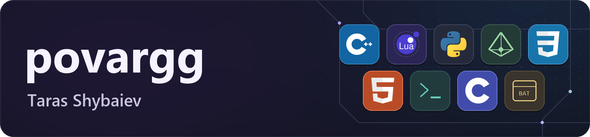
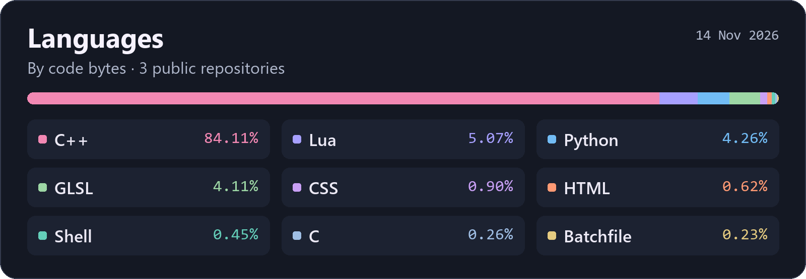
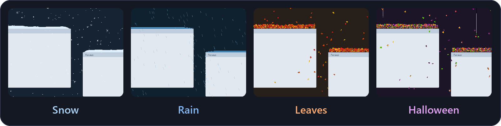

  

Windows desktop effects · Linux and Neovim customization

  <picture>
    <source media="(max-width: 600px)" srcset="./assets/languages-mobile.png">
    
  </picture>

<!-- Language shares use GitHub Linguist byte counts from the UltimateDesktopEffects, dotfiles and portfolio repositories. -->

## Featured project

### [UltimateDesktopEffects](https://github.com/povargg/UltimateDesktopEffects)

Snow, rain, pixel leaves and Halloween effects for the Windows desktop.  
`C++17` · `Direct2D` · `DirectComposition`

[Latest release](https://github.com/povargg/UltimateDesktopEffects/releases/latest) · Built on [flipkips’ LayerSnow](https://github.com/flipkips/desktop-snow-overlay).

### More projects

- [**Linux dotfiles**](https://github.com/povargg/dotfiles) · POVVIM for Neovim and a custom rmpc setup.
- [**Portfolio**](https://github.com/povargg/portfolio) · A lightweight HTML and CSS project showcase.

<!-- The banner includes adapted Skill Icons by tandpfun. License in assets/skill-icons-license.txt. -->
