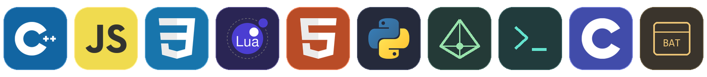
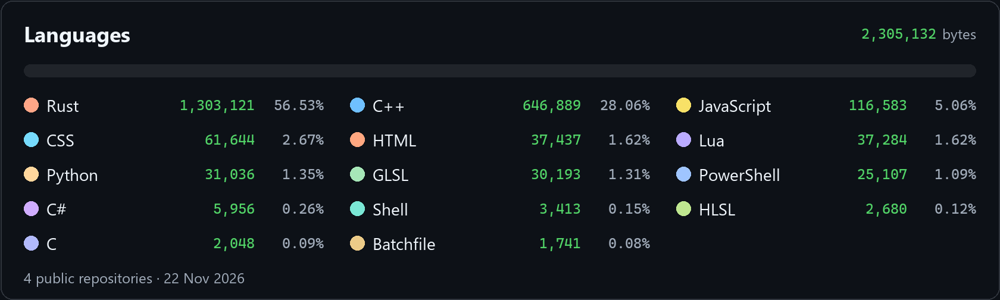
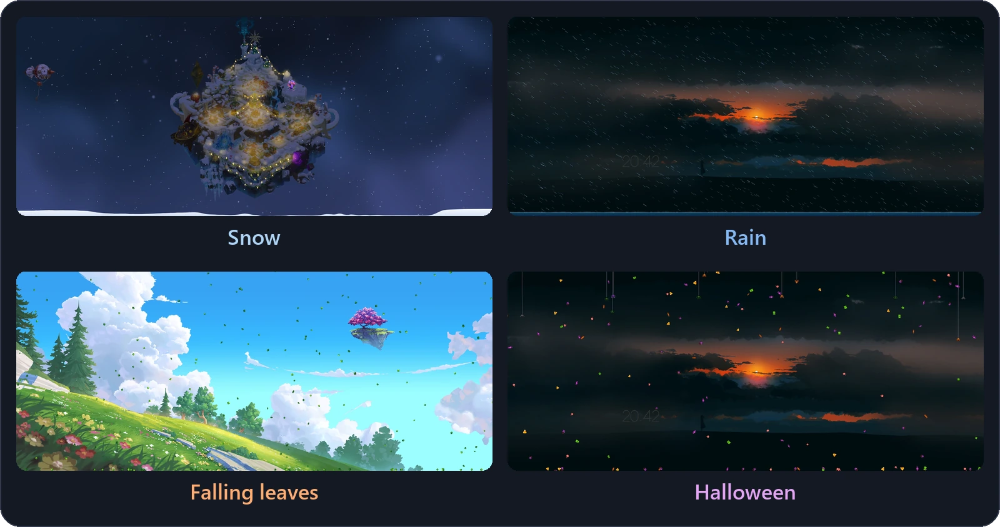

  <picture>
    <source media="(max-width: 600px)" srcset="./assets/language-icons-mobile.png">
    
  </picture>

Windows desktop effects · Linux and Neovim customization

  <picture>
    <source media="(max-width: 600px) and (prefers-reduced-motion: reduce)" srcset="./assets/language-stats-mobile.png">
    <source media="(prefers-reduced-motion: reduce)" srcset="./assets/language-stats.png">
    <source media="(max-width: 600px)" type="image/webp" srcset="./assets/language-stats-mobile.webp">
    <source type="image/webp" srcset="./assets/language-stats.webp">
    <source media="(max-width: 600px)" srcset="./assets/language-stats-mobile.gif">
    
  </picture>

<!-- Language shares use GitHub Linguist byte counts from the PovarDock, Ultimate-Desktop-Effects, dotfiles and portfolio default branches. -->

## Featured project

### [Ultimate Desktop Effects](https://github.com/povargg/Ultimate-Desktop-Effects)

Snow, rain, pixel leaves and Halloween effects for the Windows desktop.  
`C++17` · `Direct2D` · `DirectComposition`

[Latest release](https://github.com/povargg/Ultimate-Desktop-Effects/releases/latest) · Built on [flipkips’ LayerSnow](https://github.com/flipkips/desktop-snow-overlay).

### More projects

- [**PovarDock**](https://github.com/povargg/PovarDock) · My Windows 11 dock and keyboard launcher with virtual desktop shortcuts, colour palettes, and Liquid Glass.
- [**Linux dotfiles**](https://github.com/povargg/dotfiles) · POVVIM for Neovim and a custom rmpc setup.
- [**Portfolio**](https://github.com/povargg/portfolio) · A project showcase built with HTML, CSS and JavaScript.

<!-- The language icons include adapted Skill Icons by tandpfun. License in assets/skill-icons-license.txt. -->
